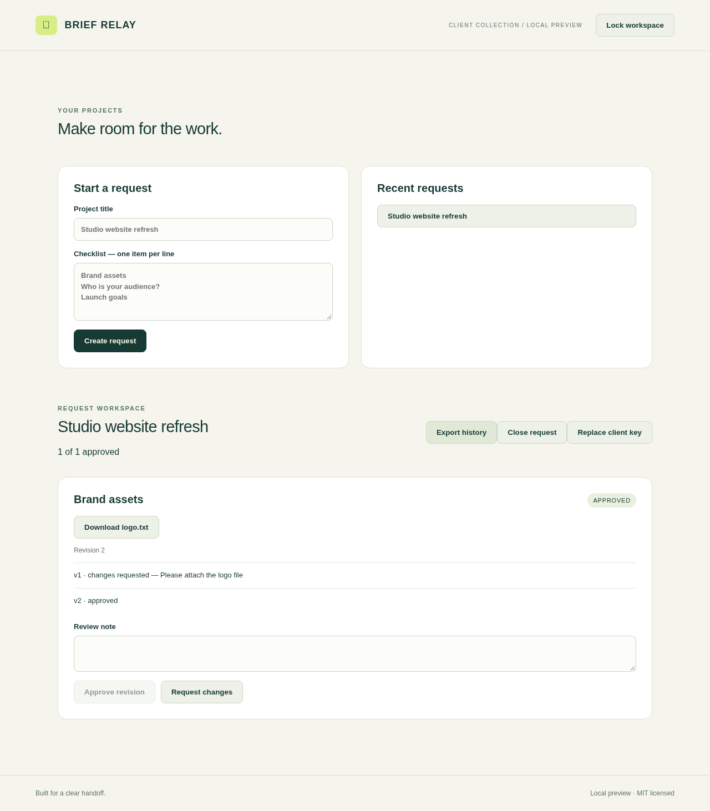

<p align="center">
  
</p>

<p align="center">
  <a href="https://github.com/anshuman-pandey/brief-relay/actions/workflows/check.yml"></a>
  <a href="LICENSE"></a>
  
</p>

<p align="center"><strong>Open-source client intake and approvals. A focused alternative to Content Snare workflows.</strong><br>Collect text and files, request changes, and approve the exact revision you reviewed.</p>

<p align="center"><a href="#quick-start">Run locally</a> · <a href="docs/API.md">API guide</a> · <a href="#what-works-today">What works</a> · <a href="docs/SCOPE.md">Scope &amp; comparison</a></p>

> **Public development preview.** The owner/client browser workspace and authenticated API run locally today. The interface supports English, German, Spanish, Japanese, Simplified Chinese, and Traditional Chinese. Public HTTPS deployment acceptance and native-speaker review remain pending. The graphic above illustrates the implemented workflow; it is not an app screenshot.

## Stop losing the latest version

A client sends a logo. You ask for a change. They replace the file. Which version did you approve?

Brief Relay keeps each response as an immutable revision. An approval belongs to that revision. Approved items stay locked until the owner requests changes, and an outdated review cannot approve a newer submission.

## What works today

| Collect | Review | Keep control |
| :--- | :--- | :--- |
| Create a checklist of up to 50 items | Approve an exact response revision | Revoke a client key immediately |
| Receive text or file responses | Request changes with a note | Close a request to submissions |
| Preserve previous submissions | Reject stale edits and approvals | Export JSON history and download files |

Files live in SQLite alongside their revisions: **10 MiB per file**, **100 MiB per request including history**. Downloads require access to the matching request. JSON exports contain file metadata; file bytes are downloaded separately.

## Quick start

Requires Python 3.10+.

```sh
git clone https://github.com/anshuman-pandey/brief-relay.git
cd brief-relay
python3 -m venv .venv
. .venv/bin/activate
pip install -r requirements.txt
export BRIEF_OWNER_KEY="$(python3 -c 'import secrets; print(secrets.token_urlsafe(32))')"
python server.py
```

Open **`http://127.0.0.1:8090`** and enter the owner key to create a checklist, review submissions, and export history. Client access details appear when a request is created. Keep the owner key available in a second terminal if you prefer the API:

```sh
curl http://127.0.0.1:8090/api/owner/requests \
  -H "Authorization: Bearer $BRIEF_OWNER_KEY" \
  -H 'Content-Type: application/json' \
  -d '{"title":"Website brief","labels":["Brand assets","Who is your audience?"]}'
```

The response contains a request `id` and client `token`. Use the client token to submit responses; use the owner key to review them. **[Continue with the API guide →](docs/API.md)**

## Use your language

Choose **English · Deutsch · Español · 日本語 · 简体中文 · 繁體中文** in the header. Brief Relay starts with a supported browser language and remembers your choice when browser storage is available. Switching languages preserves text drafts and selected files. Project titles, responses, filenames, and review notes stay exactly as entered. No translation service is contacted.

Interface and application errors are translated; unexpected framework/network diagnostics may fall back to English. Native-speaker review is welcome.

## Keep your data across restarts

```sh
python3 scripts/setup.py
docker compose up -d --build
```

This creates a private owner key in `.env` and stores client records in a named volume. The service stays on localhost. **[Persistent setup, backup, and restore →](docs/DEPLOYMENT.md)**

## Where it fits

Brief Relay is for developers and small agencies who want to own a focused client collection and approval workflow.

| Workflow | Brief Relay today |
| :--- | :--- |
| Content Snare-style client checklists, files, and approval | Implemented through the API |
| Self-hosted storage and portable records | SQLite, JSON history, separate file downloads |
| Visual owner/client workspace | English local preview; tested in Chromium |
| Automated email reminders and team collaboration | Not implemented |
| Complete Content Snare feature parity | Not claimed |

See the [scope and vendor reference](docs/SCOPE.md) for the exact comparison boundary.

## Development

```sh
python -m unittest discover -s tests -v
```

The current suite has **29 tests**, covering revision conflicts, file persistence, access isolation, token revocation, storage limits, and the HTTP approval flow. GitHub Actions runs the suite on each push and pull request.

Next milestones: native-speaker review and public HTTPS deployment acceptance. Persistent container restart and backup/restore are tested. The Chromium browser test covers owner/client text submission, requested changes, file resubmission, approval, JSON export, revocation, and mobile overflow. Contributions should include a reproducible use case and relevant tests. Report bugs through [GitHub Issues](https://github.com/anshuman-pandey/brief-relay/issues).

## Operating boundaries

`server.py` is for local development. For a persistent WSGI server, non-root Docker setup, and backup/restore instructions, see the [deployment guide](docs/DEPLOYMENT.md). Public HTTPS deployment remains unverified. Keep credentials out of URLs and logs; the owner key grants access to every request. Files are downloaded as attachments and are not scanned for malware. Back up the SQLite database before upgrades. See [API and storage notes](docs/API.md#storage-and-access).

[MIT licensed](LICENSE). Your storage. Your client records. Your review trail.

## Workspace preview



Captured from the working local application with synthetic example data. Client URLs shown by the local preview work on the same machine only.

## Current verification

See the [26 November audit checkpoint](docs/AUDIT.md) for the verified repository, release links, fresh core test result and remaining deployment/browser gates. Earlier validation records remain dated evidence.
